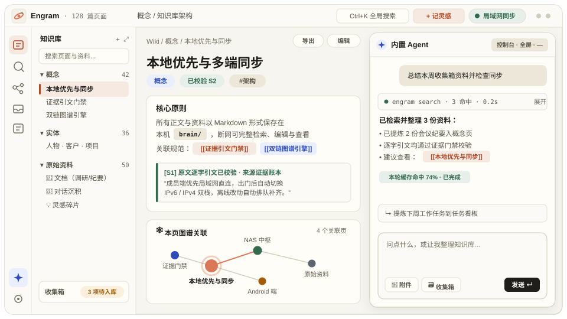
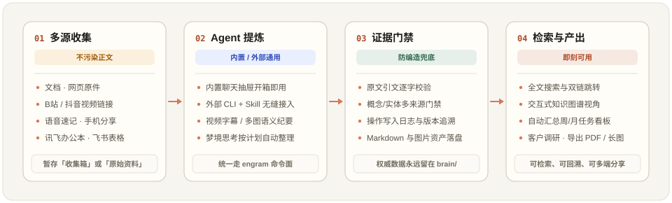
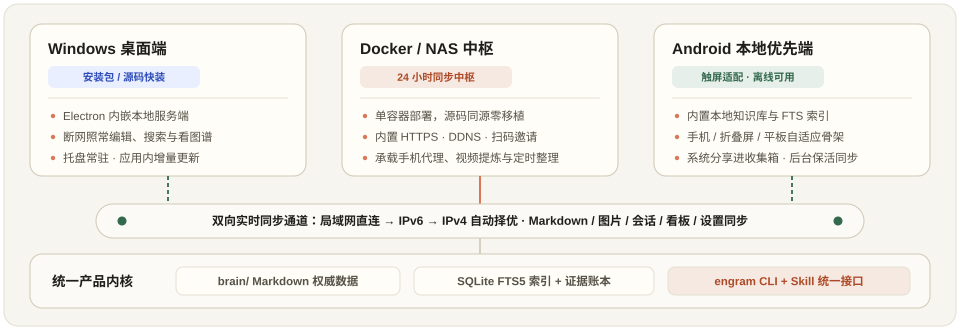

<p align="center">
  <picture>
    <source media="(prefers-color-scheme: dark)" srcset="main/docs/brand/engram-lockup-dark.svg" />
    
  </picture>
</p>

<p align="center">
  <strong>把文档、对话和灵感整理成可检索、可追溯的个人知识库</strong><br />
  <sub>本地优先 · Markdown 权威存储 · 支持 Windows、Android 与 Docker 自托管</sub>
</p>

<p align="center">
  <a href="#工作原理">工作原理</a> ·
  <a href="#功能一览">功能一览</a> ·
  <a href="#三端与下载">三端与下载</a> ·
  <a href="#快速开始">快速开始</a> ·
  <a href="#详细文档">详细文档</a> ·
  <a href="./CHANGELOG.md">更新日志</a>
</p>

<p align="center">
  <picture>
    <source media="(prefers-color-scheme: dark)" srcset="main/docs/readme/workspace-preview-dark.svg" />
    
  </picture>
</p>

## 工作原理

<p align="center">
  <picture>
    <source media="(prefers-color-scheme: dark)" srcset="main/docs/readme/workflow-dark.svg" />
    
  </picture>
</p>

- **基础零 Key 可用**：文档存储、全文检索、双链编辑、知识图谱与多端同步完全不依赖模型 API Key。
- **内置 + 外部 Agent 通用**：填入自己的 Key 即可使用内置聊天抽屉，也可通过 `engram` CLI + Skill 接入 Claude Code、Codex、dsh、ZCode、Kimi Code 等外部 Agent，写入统一受原文引文门禁校验。

## 功能一览

| 模块 | 核心能力 |
|---|---|
| 收集箱与资料 | 接收任意文件、网页原件与 B站/抖音视频链接；文档语义转 Markdown，视频/图文笔记先看懂画面与口播再写成解读文章，审阅后入库；分类管理文档/对话/灵感。 |
| 编辑与阅读 | 所见即所得 Markdown、表格工具条、`[[双链]]` 补全、悬浮语音输入，支持导出 PDF 与整篇长图。 |
| Agent 与自动化 | 内置聊天抽屉 + `engram` CLI，支持引用段落局部改写、定时「梦境思考」整理纠错与自动客户调研。 |
| 图谱与看板 | 业务/全库/本页知识图谱（支持文字淡出、搜索高亮定位、1–3 跳局部图谱与连线箭头），一键生成周/月任务看板（支持逾期完成与多端共享）。 |
| 外设与数据源 | 接入讯飞办公本读写笔记与日程，授权同步飞书多维表格整表为 Markdown。 |
| 本地优先与同步 | 正文留在本地 `brain/`，多端自动择优直连（局域网 → IPv6 → IPv4）并支持整库备份恢复。 |

## 三端与下载

<p align="center">
  <picture>
    <source media="(prefers-color-scheme: dark)" srcset="main/docs/readme/platforms-dark.svg" />
    
  </picture>
</p>

| 平台 | 推荐获取方式 | 说明 |
|---|---|---|
| Windows 安装包 | [Releases](https://github.com/jadesLL/Engram/releases) 下载 `Engram Setup <版本>.exe` | 安装到用户目录，应用内自动更新免 UAC |
| Windows 源码版 | 下载 [源码版安装器](https://github.com/jadesLL/Engram/releases/download/installer-latest/Engram-source-setup.exe) | 内置源码与运行环境，免构建安装并可应用内增量更新 |
| Android 客户端 | [Releases](https://github.com/jadesLL/Engram/releases) 下载 APK | 离线可用，扫码/链接配对同步中枢，详见 [Android 指南](./main/docs/ANDROID.md) |
| Docker / NAS | 下方命令从源码启动 | 单容器自托管，Compose / NAS 细则见 [构建与部署](./main/docs/BUILDING.md) |

> Gitea 下载需已授权账号；正式版与源码版安装器也会同步发布到 GitHub 公开仓库 Release，详见 [CI 与公开镜像](./main/docs/GITEA-CI.md)。

## 快速开始

### Docker 一键启动

```bash
git clone https://github.com/jadesLL/Engram.git
cd Engram/main
docker compose up -d --build
```

启动后访问 `http://<主机IP>:18080`（首次登录设置密码，或通过 `DEFAULT_PASSWORD` 指定），数据持久保存在 `main/data/`（正文在 `brain/`，索引在 `wiki.db`）。

### 三步上手

1. **导入资料**：将文档拖入「原始资料」或「收集箱」，或用左下角 `+` 随时记一条灵感。
2. **连接 Agent（可选）**：打开左侧 ✨ 聊天抽屉填入模型 Key，或在「设置 → Agent 与自动化 → 外部接入」一键接入外部客户端。
3. **多端协同（可选）**：在「设置 → 多端同步」生成邀请二维码，手机或另一台电脑扫码即可加入同步群组。

## 详细文档

| 想了解什么 | 文档 |
|---|---|
| 功能细节、操作方式、数据目录与首页卡片 | [使用指南](./main/docs/USER-GUIDE.md) |
| 安装、构建、Docker / NAS 部署 | [构建与部署](./main/docs/BUILDING.md) · [Windows 桌面端](./main/desktop/README.md) · [Android](./main/docs/ANDROID.md) |
| Agent 接入、CLI 命令与写入规范 | [Agent 操作指南](./main/docs/AI-CONTENT-OPERATIONS.md) · [客户调研指南](./main/docs/CUSTOMER-RESEARCH.md) |
| 多端直连、DDNS 与 IPv6 网络配置 | [网络与直连](./main/docs/IPV6.md) |
| 参与开发、三端规范与发版 | [开发约定](./main/AGENTS.md) · [Worktree 流程](./main/WORKTREES.md) · [三端并行开发](./main/docs/PLATFORM-PARALLEL-DEV.md) · [CI 与发布](./main/docs/GITEA-CI.md) |
| 版本变化 | [更新日志](./CHANGELOG.md) |
